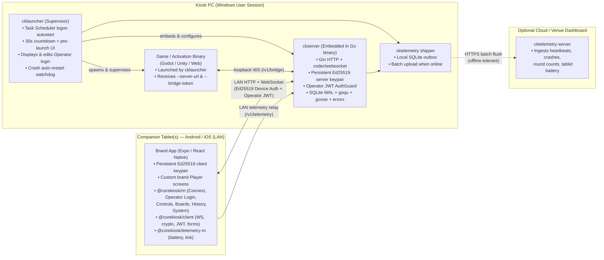
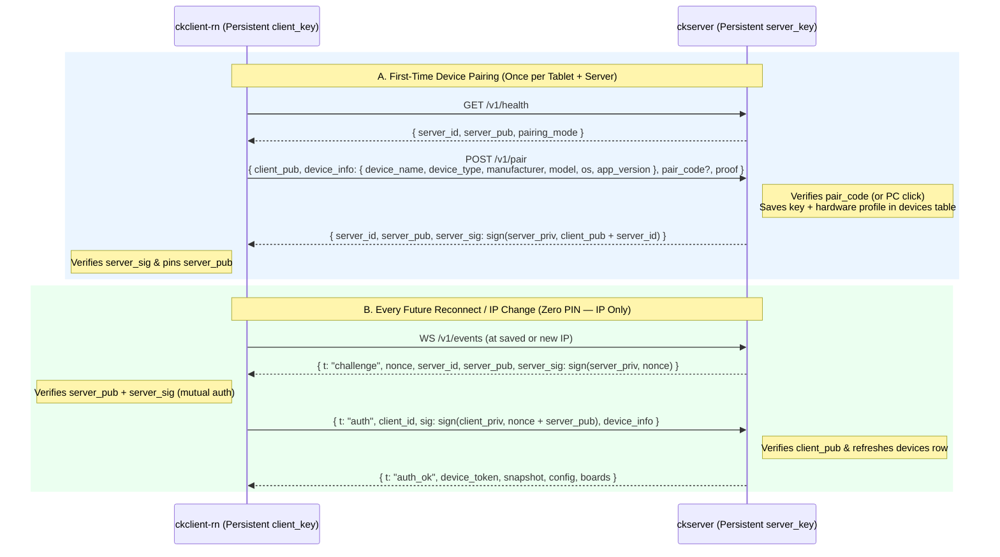
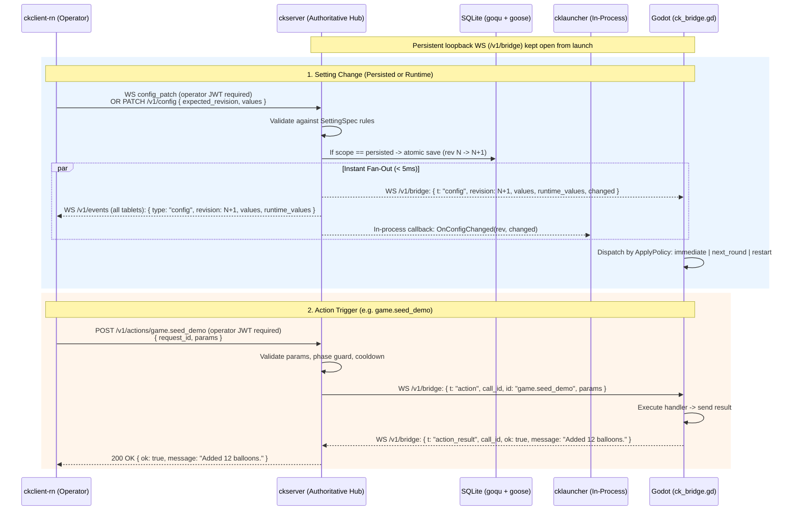
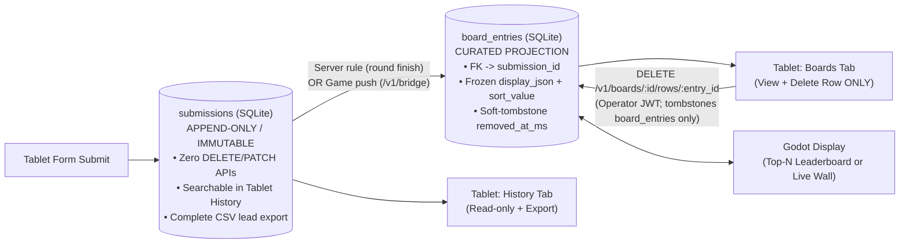

# corekiosk — Repository & Architecture Layout (Draft for Review)

`corekiosk` is a multi-language monorepo (Go + TypeScript/React Native) for building, packaging, operating, and monitoring brand-activation kiosk installations.

---

## 1. Runtime Architecture & Core Stack



### Process Ownership Rule
- **Go binary (`cklauncher` + `ckserver`) is always the parent process.**
- On Windows boot/logon, `cklauncher` starts in the interactive kiosk user session (via **Task Scheduler `At log on`**, not a Session 0 Windows Service so GPU/DirectX/Leap/webcam access works cleanly).
- `cklauncher` starts `ckserver`, shows a **30-second countdown** (displaying LAN IP, pairing status, and current Operator credentials for booth setup), and spawns the game binary with `--server-url http://127.0.0.1:<port>` (plus loopback bridge token).
- If the game crashes, `ckserver` stays alive, tablets stay connected, a crash event is queued to telemetry, and `cklauncher` restarts the game unless an operator cancels.

### Mandatory Go Libraries & Engineering Conventions
| Concern | Library | Usage in `corekiosk` |
| :--- | :--- | :--- |
| HTTP Router | `github.com/gin-gonic/gin` | REST API, device auth middleware, Operator JWT AuthGuard |
| WebSocket | `github.com/coder/websocket` | Tablet `/v1/events` fan-out & loopback Game `/v1/bridge` |
| SQLite Driver | `modernc.org/sqlite` | Pure-Go embedded SQLite (WAL mode, no CGO required on Windows) |
| Query Builder | `github.com/doug-martin/goqu/v9` | All SQL queries built with `goqu.Dialect("sqlite3")` — zero raw string concatenation |
| Schema Migrations | `github.com/pressly/goose/v3` | Embedded versioned SQL migrations (`//go:embed migrations/*.sql`) run automatically on DB open |
| Structured Errors | `github.com/joomcode/errorx` | Namespaced typed errors (`ck.auth`, `ck.validation`, `ck.conflict`, `ck.not_found`, `ck.bridge`, `ck.store`) with traits mapped centrally to HTTP/WS status codes |
| Operator Auth | `github.com/golang-jwt/jwt/v5` + `golang.org/x/crypto/argon2` | EdDSA (Ed25519) JWTs bound to `(operator_id, device_id)`; Argon2id password hashing |

---

## 2. Monorepo Directory Layout

Single repo with a **Go workspace** (`go.work`) and a **pnpm workspace** (`pnpm-workspace.yaml`) so Go libraries, TypeScript/RN packages, and reference activations stay version-locked together.

```text
corekiosk/
├── README.md
├── LAYOUT.md
├── TELEMETRY.md                    # Local-first telemetry, peer mule sync & Cloudflare Worker + D1 architecture
├── VERSIONING.md                   # 4-track SemVer (ckframework, cklauncher, client, game) & protocol handshake
├── go.work                         # Links all Go modules locally
├── pnpm-workspace.yaml             # Links all JS/TS/RN packages & examples
├── package.json                    # Root scripts (codegen, lint, test)
│
├── go/
│   ├── ckframework/                # Declarative kiosk/game schema, contracts & error taxonomy
│   │   ├── go.mod
│   │   ├── version.go              # CKFramework SemVer + integer ProtocolVersion (source of truth for codegen)
│   │   ├── app.go                  # AppSpec (Name, Version, MinClientVersion, Phases, Form, Settings, Actions, Boards)
│   │   ├── phase.go                # Phase definitions, transitions, deadlines, guard timeouts
│   │   ├── form.go                 # Registration/lead-capture FormSpec (CKTelemetryTransmit=true default) + validators
│   │   ├── setting.go              # Typed SettingSpec (bool/int/number/enum/multi_enum/text/color, scope, apply, visible_if)
│   │   ├── action.go               # Stateless ActionSpec triggers (server/game/launcher, params, confirm, cooldown)
│   │   ├── board.go                # Server- & Game-defined BoardSpec (columns, sort, filter, limit, delete-only rules)
│   │   ├── protocol.go             # Canonical Snapshot, Submission, BoardRow, BridgeMessage, ActionResult structs
│   │   ├── errors.go               # Shared errorx namespaces & traits (Auth, Validation, Conflict, Bridge, Store)
│   │   └── codegen/                # Generates JSON Schema + TypeScript types for js/packages/client
│   │
│   ├── ckserver/                   # Reusable Gin + coder/websocket server library
│   │   ├── go.mod
│   │   ├── server.go               # New(spec *ckframework.AppSpec, opts ...Option)
│   │   ├── keys.go                 # Persistent Ed25519 server identity keypair (load-or-generate)
│   │   ├── device_auth.go          # One-time device pairing + Ed25519 challenge-response (zero-PIN reconnect)
│   │   ├── operator_auth.go        # Operators CRUD, Argon2id hashing, EdDSA JWT issue/verify, Gin AuthGuard
│   │   ├── hub.go                  # Authoritative phase machine, guard timers, live config/board/action routing
│   │   ├── http.go                 # Fixed REST routes + centralized errorx -> HTTP JSON error mapper
│   │   ├── bridge.go               # Loopback game-engine bridge (WS /v1/bridge)
│   │   ├── submissions.go          # Immutable form submission ledger (append-only, search, CSV export)
│   │   ├── boards.go               # Server/game curated boards (upsert, rank, soft-tombstone delete, no edit)
│   │   ├── actions.go              # Action validation, cooldown enforcement & target dispatcher
│   │   ├── store/
│   │   │   ├── db.go               # SQLite open + goose.Up() runner + goqu.Dialect("sqlite3") wrapper
│   │   │   ├── migrations/
│   │   │   │   ├── 00001_init.sql          # devices (paired keys + device_name/type/info), operators (+ default seed), settings
│   │   │   │   ├── 00002_submissions.sql   # immutable submissions & rounds tables
│   │   │   │   ├── 00003_boards.sql        # board_definitions & board_entries (with tombstones)
│   │   │   │   └── 00004_telemetry.sql     # local-first telemetry_outbox & peer sync cursors
│   │   │   └── queries_*.go        # goqu-built queries (devices, operators, settings, submissions, boards, telemetry)
│   │   └── telemetry_relay.go      # Bidirectional LAN relay (/v1/telemetry/ingest, /pull, /ack)
│   │
│   ├── cklauncher/                 # Windows supervisor, pre-launch settings UI & packager
│   │   ├── go.mod
│   │   ├── launcher.go             # Run(srv *ckserver.Server, cfg LauncherConfig)
│   │   ├── supervisor.go           # Child process spawn, env/flag injection, crash auto-restart
│   │   ├── countdown.go            # 30s pre-launch countdown state machine (pause/edit/launch)
│   │   ├── ui/                     # Pre-launch UI: countdown, settings, operator creds, paired devices, Telemetry Explorer
│   │   ├── winautostart/           # Windows Task Scheduler logon installer + uninstall CLI
│   │   └── cmd/ckpack/             # CLI packager: bundles launcher.exe + ./game/ + manifest
│   │
│   └── cktelemetry/                # Telemetry SDK + optional ingest server
│       ├── go.mod
│       ├── event.go                # Event envelope (device_id, app, kind, payload, ts)
│       ├── shipper.go              # Offline SQLite outbox (goqu + goose) + background HTTPS batch uploader
│       └── cmd/cktelemetry-server/ # Standalone ingest API + basic status/alert storage
│
├── js/
│   ├── packages/
│   │   ├── client/                 # @corekiosk/client (Headless TypeScript SDK — zero UI)
│   │   │   ├── package.json
│   │   │   └── src/
│   │   │       ├── generated/      # Auto-generated types from go/ckframework/codegen
│   │   │       ├── crypto.ts       # Persistent Ed25519 client keypair + challenge signing/verification
│   │   │       ├── api.ts          # Typed HTTP client (device auth, operator JWT login, settings, actions, boards, history)
│   │   │       ├── socket.ts       # WebSocket with mutual key auth, operator_auth elevation, clock-offset sync
│   │   │       ├── store.ts        # Reactive KioskStore (snapshot, config, boards, schema, operator session)
│   │   │       ├── form.ts         # Dynamic validator driven by /v1/schema form & action param fields
│   │   │       └── storage.ts      # Pluggable persistence adapter (SecureStore / AsyncStorage / Web)
│   │   │
│   │   ├── rn/                     # @corekiosk/rn (React Native / Expo UI & kiosk toolkit)
│   │   │   ├── package.json
│   │   │   ├── app.plugin.js       # Expo config plugin (LAN cleartext HTTP, keep-awake, nav bar)
│   │   │   └── src/
│   │   │       ├── provider.tsx    # <KioskProvider> wiring @corekiosk/client + persistent key storage
│   │   │       ├── router.tsx      # <KioskPhaseRouter> mapping phases -> brand screens
│   │   │       ├── screens/
│   │   │       │   ├── ConnectScreen.tsx       # Enter IP (auto-reconnects if paired; key exchange if new)
│   │   │       │   ├── OperatorLoginModal.tsx  # Username + Password gate -> Operator JWT (in-memory only)
│   │   │       │   └── OperatorScreen.tsx      # Auto-rendered tabs: Controls | Boards | History | System
│   │   │       ├── components/
│   │   │       │   ├── DynamicForm.tsx         # Renders registration forms & Action parameter sheets
│   │   │       │   ├── ControlsTab.tsx         # Grouped SettingSpec widgets + ActionSpec buttons
│   │   │       │   ├── BoardsTab.tsx           # Server/Game boards viewer + Delete Row (no edit)
│   │   │       │   ├── HistoryTab.tsx          # Read-only searchable immutable submissions + CSV export
│   │   │       │   └── ConnectionBadge.tsx     # Live WS link status chip
│   │   │       └── hooks/
│   │   │           ├── useKiosk.ts             # Access snapshot, phase, boards, config, actions
│   │   │           ├── useOperator.ts          # Operator login/logout, JWT state, idle auto-lock
│   │   │           ├── useServerClock.ts       # Drift-corrected countdown/elapsed timer
│   │   │           └── useKioskMode.ts         # Keep screen on + immersive full-screen
│   │   │
│   │   └── telemetry-rn/           # @corekiosk/telemetry-rn (RN device health & events)
│   │       ├── package.json
│   │       └── src/
│   │           ├── collector.ts    # Battery %, charging state, Wi-Fi/WS drops, app errors
│   │           ├── queue.ts        # Offline AsyncStorage/MMKV event buffer
│   │           └── transport.ts    # Sends to ckserver /v1/telemetry (LAN) or direct HTTPS
│   │
│   └── tsconfig.base.json
│
├── adapters/                       # Thin game-engine clients for the loopback bridge
│   ├── godot/
│   │   └── ck_bridge.gd            # Connects to --server-url; handles config, actions, boards, phases
│   └── web/
│       └── ck-bridge.ts            # For HTML5 / Electron / WebGL kiosk games
│
└── examples/
    └── template-activation/        # Minimal working starter showing how a real project wires everything
        ├── server/main.go          # ~50 lines: ckframework spec -> ckserver -> cklauncher.Run
        ├── game/                   # Dummy/minimal game binary for testing supervisor & bridge
        └── client-rn/              # Expo app using @corekiosk/rn with custom brand Player screens
```

---

## 3. Two-Layer Authentication: Device Keys + Operator AuthGuard

Authentication is split into two distinct layers so **connecting a paired tablet never asks for a PIN**, while **entering the Operator Panel always requires Operator credentials**:

### Layer 1 — Persistent Device Keypair (Zero-PIN IP-Only Reconnect)
Both sides generate a persistent **Ed25519** keypair on first launch:
- **Server (`ckserver`)**: `./data/server.key` (`server_priv`, `server_pub`, `server_id = sha256(server_pub)[:8]`).
- **Client (`ckclient-rn`)**: Device SecureStore/Keystore (`client_priv`, `client_pub`, `client_id = sha256(client_pub)[:8]`).



### Layer 2 — Operators & JWT AuthGuard (Operator Panel Access)

Launching the Operator Panel on the tablet always requires an **Operator username + password**, guarded server-side by an **EdDSA (Ed25519) JWT**.

```mermaid
sequenceDiagram
    participant Op as Booth Staff (Tablet)
    participant RN as ckclient-rn (OperatorLoginModal)
    participant Srv as ckserver (JWT AuthGuard)
    participant Launch as cklauncher (Booth PC UI)

    Note over Launch: Displays booth operator info:<br/>Default -> username: operator / password: operator<br/>Editable anytime in cklauncher UI

    Op->>RN: Tap hidden Operator trigger (e.g. long-press logo)
    RN->>Op: Show OperatorLoginModal (username, password)
    RN->>Srv: POST /v1/operators/login<br/>Headers: X-Device-Token<br/>Body: { username, password }
    Srv->>Srv: Lookup operators table (goqu) + verify Argon2id hash
    Srv-->>RN: 200 OK { access_token (EdDSA JWT), expires_at_ms, operator: { id, username } }
    Note left of RN: Holds JWT in memory ONLY<br/>(never persisted; clears on exit / idle timeout)

    RN->>Srv: WS /v1/events: { t: "operator_auth", token: "<jwt>" }
    RN->>Srv: Privileged REST calls:<br/>Headers: X-Device-Token + Authorization: Bearer <jwt>
    Srv->>Srv: RequireOperator() Gin AuthGuard:<br/>1. Verify EdDSA JWT signature (server_pub)<br/>2. Verify exp & token_version (revokes on password change)<br/>3. Verify claim device_id == authenticated tablet<br/>4. Attach operator_id + username for audit log
```

#### Operator Rules & `cklauncher` UX
- **Default seeded operator**: Goose migration / bootstrap ensures an initial operator account exists with **`username: operator`** and **`password: operator`**.
- **Visible & editable in `cklauncher`**:
  - During the booth pre-launch screen and settings UI, `cklauncher` displays the booth operator credentials (`Username: operator` / `Password: operator` while on defaults, plus a button to **Change Username/Password** or **Add/Reset Operators** directly on the kiosk PC).
  - Changing an operator's password increments `token_version` in SQLite, **immediately invalidating** any previously issued JWTs for that operator.
- **What the Operator JWT AuthGuard protects**:
  - **Device-only (no operator login needed)**: `/v1/health`, `/v1/schema`, `/v1/state`, `/v1/submissions` (`POST`), `/v1/rounds` (`POST`, cancel active player round), `/v1/boards/:id` (`GET` public display), `/v1/telemetry`, `WS /v1/events` (read-only snapshots).
  - **Operator AuthGuard required (`RequireOperator()`)**:
    - `GET/PATCH /v1/config` & WS `config_patch`
    - `POST /v1/actions/:id` (all server/game/launcher triggers)
    - `DELETE /v1/boards/:board_id/rows/:entry_id` (moderating leaderboard/wall rows)
    - `GET /v1/submissions` & `GET /v1/submissions/export.csv` (viewing/exporting historical attendee PII/leads)
    - `GET/POST/DELETE /v1/devices` (paired tablet management) & `GET/POST/PATCH/DELETE /v1/operators`

---

## 4. Deep Admin Control Schema: `Settings` vs. `Actions` (Triggers)

`ckframework` cleanly separates **stateful configuration (`SettingSpec`)** from **stateless commands/triggers (`ActionSpec`)**. Both share UI `Group` names so `OperatorScreen` renders related settings and triggers together.

### A. Typed Settings (`SettingSpec`)

| `Type` | Wire Value | Tablet UI Widget | Extra Metadata |
| :--- | :--- | :--- | :--- |
| `bool` | `boolean` | Switch | — |
| `int` | `integer` | Stepper / Slider | `min`, `max`, `step`, `unit` (`"ms"`, `"rows"`) |
| `number` | `float` | Slider / Numeric input | `min`, `max`, `step`, `precision`, `unit` (`"s"`, `"dB"`, `"%"`) |
| `enum` | `string` | Segmented pills (≤4) or Picker (>4) | `options: [{ value, label, help? }]` |
| `multi_enum` | `string[]` | Toggle chips | `options: [{ value, label }]`, `min_selected?` |
| `text` | `string` | Text input | `max_len`, `placeholder`, `multiline`, `pattern?` |
| `color` | `string` (`#RRGGBB`) | Color swatch / hex picker | `presets?` |

Every `SettingSpec` also declares:
- **`Scope`**:
  - `persisted` (default): Stored in SQLite, survives restarts (`display.mode`, `audio.sfx_volume_db`).
  - `runtime` (ephemeral): Synced live to Godot + tablets, **never persisted to SQLite**, resets on restart (`debug.pause_physics`, `display.show_hitboxes`, `debug.show_mask`). Prevents leaving a booth stuck in debug mode after a reboot.
- **`Apply`**: `immediate` | `next_round` | `restart`
- **`VisibleIf`** (optional predicate): e.g. `display.crt_model` visible only when `display.crt_enabled == true`; `game.round_seconds` visible only when `game.mode == "timed"`.

### B. Stateless Triggers (`ActionSpec`)

Triggers represent **commands that happen** rather than values that stay (e.g., `Add 12 demo balloons`, `Clear live wall`, `Recalibrate sensor`, `Send test spotlight`, `Force cancel round`, `Restart game`).

```go
type ActionSpec struct {
    ID            string        // e.g. "game.seed_demo", "launcher.restart_game"
    Group         string        // Section in ControlsTab alongside related settings
    Label         string        // Button label
    Help          string        // Optional description
    Target        ActionTarget  // "server" | "game" | "launcher"
    Style         ActionStyle   // "default" | "primary" | "danger"
    Confirm       ConfirmPolicy // "none" | "dialog" | "type_confirm"
    ConfirmText   string        // Prompt shown when Confirm != "none"
    Params        []FormField   // Optional! Tablet opens DynamicForm modal before firing
    EnabledPhases []string      // Optional phase guard (empty = always enabled)
    CooldownMs    int           // Prevents accidental rapid double-taps
}
```

### C. Real-Time Settings & Action Sync Chain (Tablet ↔ `ckserver` ↔ Godot)



- **Dynamic Game Capabilities**: In `{ t: "ready", capabilities: { settings: [...], actions: [...], boards: [...] } }`, Godot can register extra game-only `runtime` settings, `game`-target triggers, or game-managed boards at runtime—`ckserver` merges them into `/v1/schema` automatically.
- **Bidirectional PC Mirroring**: Changes made in Godot's local debug/BIOS UI or `cklauncher` send `config_patch` through `ckserver`, persisting and broadcasting immediately to all tablets.

---

## 5. Immutable Form History vs. Server/Game-Defined Leaderboards ("Boards")

`corekiosk` strictly separates **append-only historical form submissions** from **curated display boards/leaderboards**.



### A. Immutable Form History (`submissions`) & `CKTelemetryTransmit`
- Every `ckframework` form defaults to **`CKTelemetryTransmit` (`TelemetryTransmit: true`)** (opt-out via `.WithoutTelemetryTransmit()`).
- Submitting a form atomically writes:
  1. An **append-only** row in `submissions` (`id`, `request_id` unique, `form_id`, `form_version`, `payload_json`, `source_device_id`, `round_id`, `status`, `outcome_json`, `created_at_ms`), AND
  2. A `form.submission` record in `telemetry_outbox` so it syncs local-first (direct or via Tablet mule) into the **Cloudflare D1 `form_submissions` table** (merging asynchronously with `form.outcome`). See [TELEMETRY.md](./TELEMETRY.md) for the full sync & conflict-free model.
- **Device Attribution**: Every paired key is stored in `devices` with rich metadata (`device_name`, `device_type`, `manufacturer`, `model`, `os_name`, `os_version`, `app_version`, `device_info_json`), so both `cklauncher`'s **Telemetry Explorer** and Cloudflare D1 clearly attribute every form row and telemetry event to the exact server or paired client device.
- **Framework Invariant**: **No `DELETE`, `PUT`, or `PATCH` endpoint exists on `/v1/submissions`**.
- Operators browse, filter, and search submissions in the tablet's **History** tab (`GET /v1/submissions?cursor=...&q=...`) or `cklauncher`'s **Telemetry Explorer**, and export full leads via `GET /v1/submissions/export.csv`—even for entries later removed from a public leaderboard or live wall.

### B. Server- & Game-Defined Boards (`BoardSpec`)
Both an arcade **Top Scores Leaderboard** (e.g. Joyland2) and a **Live Wishing Wall** (e.g. `../esse`'s 30 floating balloons) use the exact same `BoardSpec` primitive:

1. **Server-Defined Board** (declared in Go `ckframework`):
   - `ckserver` inserts a `board_entries` row referencing `submission_id` whenever a round finishes (or form submits), sorting by `sort_value`, applying filters/dedupe/window/limit (which can bind to a setting like `display.leaderboard_limit`).
2. **Game-Defined / Game-Managed Board** (declared in Go with `Source: GameManaged`, or dynamically announced by Godot via `{ t: "board_define", board: {...} }`):
   - Godot pushes rows via `{ t: "board_upsert", board_id, entry_id, submission_id?, sort_value, display: {...} }`, with optional FIFO cap (`max_rows: 30`, `eviction: "fifo"`).

### C. Delete-Only Moderation (No Content Modification)
- `board_entries` stores `(board_id, entry_id, submission_id, sort_value, display_json, created_at_ms, removed_at_ms, removed_by_operator_id)`.
- **No `PATCH`/`PUT` endpoint exists on board rows**—operators can never alter a player's name, score, or message.
- Calling `DELETE /v1/boards/:board_id/rows/:entry_id` (requires Operator JWT):
  1. Soft-tombstones `removed_at_ms = now`, `removed_by_operator_id = op.ID` via `goqu` update (leaving `submissions` completely untouched).
  2. Immediately broadcasts:
     - To Godot (`/v1/bridge`): `{ t: "board_row_removed", board_id, entry_id }` + `{ t: "board_snapshot", board_id, rows }` (so `../esse` pops that exact balloon live, or Joyland2 promotes rank #9 into #8).
     - To all tablets (`/v1/events`): `{ type: "board_updated", board_id, rows }`.
- Optional `AllowBoardClear(true)` automatically registers a danger-confirmed `ActionSpec` (`board.<id>.clear`) to clear the active board (e.g. start of Day 2) without losing Day 1's leads in `submissions`.

---

## 6. Error Handling (`errorx`) & Database Layer (`goqu` + `goose`)

### A. Error Taxonomy (`go/ckframework/errors.go`)
All Go modules construct errors using `github.com/joomcode/errorx` under a shared root namespace (`corekiosk`) with semantic traits:
- `ValidationErrors` (trait `InvalidInput`) → HTTP `400`
- `AuthErrors` (`Unauthorized` → `401`, `Forbidden` → `403`, `OperatorTokenExpired` → `401` with `code: "operator_token_expired"`)
- `ConflictErrors` (`Conflict`, e.g., revision mismatch, duplicate `request_id` payload mismatch, busy round) → HTTP `409`
- `NotFoundErrors` (`NotFound`) → HTTP `404`
- `BridgeErrors` (`Unavailable`, `Timeout` when Godot disconnects or action times out) → HTTP `503` / `504`
- `StoreErrors` (wraps SQLite / `goqu` / `goose` errors without leaking raw SQL to clients) → HTTP `500`

A single Gin helper `respondError(c, err)` inspects `errorx` traits/types and emits a uniform JSON envelope: `{ "code": "...", "error": "...", "details": {...} }`.

### B. Migrations (`goose`) & Queries (`goqu`)
- SQLite opens with `WAL`, `foreign_keys(ON)`, `busy_timeout(5000)`, `_txlock=immediate`.
- `store.Open(path)` immediately runs `goose.SetBaseFS(migrationsFS)` + `goose.SetDialect("sqlite3")` + `goose.Up(db, "migrations")`.
- All queries use `dialect := goqu.Dialect("sqlite3")` (`dialect.From("board_entries").Select(...).Where(goqu.C("removed_at_ms").IsNull())...`) for composable filters, cursor pagination, and zero SQL string-concatenation bugs.

---

## 7. How a Brand Activation Uses It

### A. Server + Launcher (`examples/template-activation/server/main.go`)

```go
spec := ckframework.NewApp("essential-pop", "1.0.0").
    WithPhases(ckframework.StandardArcadeLoop()).
    WithForm(
        ckframework.TextField("name", "Name").Required().MaxLen(32),
        ckframework.HandleField("ig_username", "Instagram").Prefix("@").MaxLen(30),
        ckframework.EmailField("email", "Email").Required().MaxLen(120),
    ).
    WithSettings(
        ckframework.EnumSetting("game.mode", "Game", "Game mode", []ckframework.EnumOption{
            {Value: "endless", Label: "Endless"},
            {Value: "timed", Label: "Timed"},
        }, "endless").ApplyNextRound(),
        ckframework.NumberSetting("game.round_seconds", "Game", "Round length", 10, 180, 5, "s", 45).
            ApplyNextRound().VisibleIf("game.mode", "timed"),
        ckframework.BoolSetting("display.fullscreen", "Display", "Fullscreen", true).ApplyImmediate(),
        ckframework.BoolSetting("display.show_hitboxes", "Display", "Show hitboxes", false).
            RuntimeOnly().ApplyImmediate(),
        ckframework.NumberSetting("audio.sfx_volume_db", "Audio", "SFX gain", -40, 6, 1, "dB", 0).ApplyImmediate(),
    ).
    WithActions(
        ckframework.Action("game.recalibrate", "Tracking", "Recalibrate sensor").TargetGame().Cooldown(3000),
        ckframework.Action("round.force_cancel", "Game", "Cancel active round").TargetServer().
            Danger().Confirm("Cancel the current player's round?").
            EnabledInPhases("awaiting_hand", "countdown", "playing"),
        ckframework.Action("launcher.restart_game", "System", "Restart game").TargetLauncher().
            Danger().Confirm("Restart the game window now?"),
    ).
    WithBoards(
        ckframework.NewBoard("top_scores", "Leaderboard").
            Columns(
                ckframework.RankColumn("#"),
                ckframework.FieldColumn("name", "Player"),
                ckframework.NumberColumn("score", "Score"),
            ).
            SortBy("score", ckframework.Desc).
            LimitFromSetting("display.leaderboard_limit", 8).
            AllowRowDelete(true).
            AllowBoardClear(true),
    )

srv, err := ckserver.New(spec,
    ckserver.WithDatabase("./data/kiosk.db"),
    ckserver.WithKeyFile("./data/server.key"),
    ckserver.WithDefaultOperator("operator", "operator"),
    ckserver.WithTelemetry(telemetryShipper),
)

// cklauncher starts ckserver, runs the 30s countdown + settings/operator UI,
// spawns ./game/app.exe with --server-url, and restarts it on crash.
cklauncher.Run(srv, cklauncher.Options{
    GameBinary:        "./game/app.exe",
    CountdownSeconds:  30,
    AutoRestartOnExit: true,
    Telemetry:         telemetryShipper,
})
```

### B. React Native Client (`client-rn/App.tsx`)

The brand app only writes the **branded Player screens**—device pairing, Operator login modal, live Controls/Boards/History/System tabs, WS sync, clock drift, and telemetry come out of the box:

```tsx
<KioskProvider>
  <KioskPhaseRouter
    // Built-in ConnectScreen, OperatorLoginModal & OperatorScreen (Controls/Boards/History/System)
    screens={{
      idle: BrandRegistrationScreen,
      awaiting_hand: BrandWaitingScreen,
      countdown: BrandCountdownScreen,
      playing: BrandPlayingScreen,
      results: BrandResultsScreen,
    }}
  />
</KioskProvider>
```

---

## 8. Fixed Wire Protocol (`ckserver`)

| Direction | Endpoint / Channel | Auth Required | Purpose |
| :--- | :--- | :--- | :--- |
| Tablet → Server | `GET /v1/health` | Public | Discovery: service name, protocol version, `server_id`, `server_pub`, display status |
| Tablet → Server | `POST /v1/pair` | Pair code / PC approval | One-time Ed25519 key exchange (`client_pub` ↔ `server_pub`) + stores `device_info` in `devices` |
| Tablet → Server | `POST /v1/auth/challenge` & `/v1/auth/verify` | Paired Device Key | Stateless Ed25519 challenge-response for REST `device_token` |
| Tablet ↔ Server | `WS /v1/events` | Paired Device Key (+ optional `operator_auth` JWT) | Live state snapshots, config broadcasts, board updates, live `config_patch`, clock-sync pings |
| Tablet → Server | `GET /v1/schema` | Paired Device | Returns `Form`, `Phases`, `Settings`, `Actions`, and `Boards` descriptors |
| Tablet → Server | `POST /v1/submissions` / `POST /v1/rounds` | Paired Device | Idempotent (`request_id`) immutable form submission + `CKTelemetryTransmit` outbox write (+ optional round arm) |
| Tablet → Server | `DELETE /v1/rounds/:id` | Paired Device | Cancel active round (e.g., player walked away) |
| Tablet → Server | `GET /v1/boards/:board_id` | Paired Device | Read current ranked/active board rows (for display) |
| Tablet ↔ Server | `POST /v1/telemetry/ingest`, `GET /pull`, `POST /ack` | Paired Device | Bidirectional local-first LAN relay & Tablet-as-Mule cloud telemetry sync (see [TELEMETRY.md](./TELEMETRY.md)) |
| Tablet → Server | `POST /v1/operators/login` | Paired Device | Verifies Operator `username` + `password` → returns EdDSA JWT bound to `device_id` |
| Tablet → Server | `POST /v1/operators/refresh` & `/logout` | Device + **Operator JWT** | Renews or ends active operator panel session |
| Tablet → Server | `GET/PATCH /v1/config` | Device + **Operator JWT** | Optimistic-concurrency (`revision`) settings sync (persisted + runtime) |
| Tablet → Server | `POST /v1/actions/:id` | Device + **Operator JWT** | Fires a typed `ActionSpec` trigger (`server` / `game` / `launcher`) with structured feedback |
| Tablet → Server | `DELETE /v1/boards/:board_id/rows/:entry_id` | Device + **Operator JWT** | Soft-tombstones a row from a board (never edits contents; never touches `submissions`) |
| Tablet → Server | `GET /v1/submissions` | Device + **Operator JWT** | Paginated, searchable read-only view of immutable historical form submissions |
| Tablet → Server | `GET /v1/submissions/export.csv` | Device + **Operator JWT** | Downloads complete historical submissions CSV |
| Tablet → Server | `GET/POST/DELETE /v1/devices` & `/v1/operators` | Device + **Operator JWT** | Manage paired tablets (revoke keys) and operator accounts |
| Game ↔ Server | `WS /v1/bridge` (loopback) | Loopback Bridge Token | Game lifecycle (`ready`, phases, `score`, `finished`, `config_patch`, `board_define`, `board_upsert`, `action_result`) & server pushes (`hello`, `arm`, `config`, `action`, `board_row_removed`, `board_snapshot`, `cancel`) |

---

## 9. Build & Packaging Model (Windows)

Running `ckpack` produces a self-contained portable folder (ready to zip or wrap in Inno Setup):

```text
dist/<app-name>/
├── <app-name>-launcher.exe    # Go binary: cklauncher + ckserver + cktelemetry shipper
├── game/                      # Unmodified Godot / Unity / Web game export
│   └── game.exe
├── kiosk.manifest.json        # Game binary path, default flags, app version
└── data/                      # Created at runtime (server.key, kiosk.db, telemetry.db, logs/)
```

- **Install autostart**: `<app-name>-launcher.exe --install-autostart` registers a Windows Task Scheduler `At log on` task (interactive user session, highest privileges).
- **Skip countdown (dev)**: `<app-name>-launcher.exe --now` or `--no-game` (server-only mode while iterating on the game in Godot/Unity editor).

---

## 10. Open Decisions for Your Review

Before writing code, let's lock down these choices:

1. **First-Time Device Pairing Approval UX**
   - When an unknown `client_pub` connects for the first time:
     - **A)** 6-digit rotating code shown on display / `cklauncher` (or QR scan), **or**
     - **B)** Click **"Approve Tablet"** directly inside `cklauncher` on the PC (zero code typing), **or** both?
2. **`cklauncher` UI Toolkit**
   - Uses **Fyne v2 (`fyne.io/fyne/v2`)** for native Go widgets (`Table`, `AppTabs`, `Select`, `Slider`, `PasswordEntry`, `Dialog`).
3. **Expo vs. Bare React Native for `ckclient-rn`**
   - Recommend **Expo (Prebuild / Dev Client)** for fast Windows dev, `expo-secure-store` (for `client_priv`), `expo-font`, `expo-keep-awake`, `react-native-svg`, and optional RN Web preview.
4. **Go Module Granularity**
   - **Single Go module** (`github.com/<org>/corekiosk` with packages `ckframework`, `ckserver`, `cklauncher`, `cktelemetry`) vs. 4 separate `go.mod` files?
5. **Operator JWT Idle Auto-Lock**
   - When an operator unlocks the Operator Panel on a shared booth tablet, should the JWT automatically lock/clear after **5 minutes of inactivity** (plus immediately when exiting the Operator Panel)?
