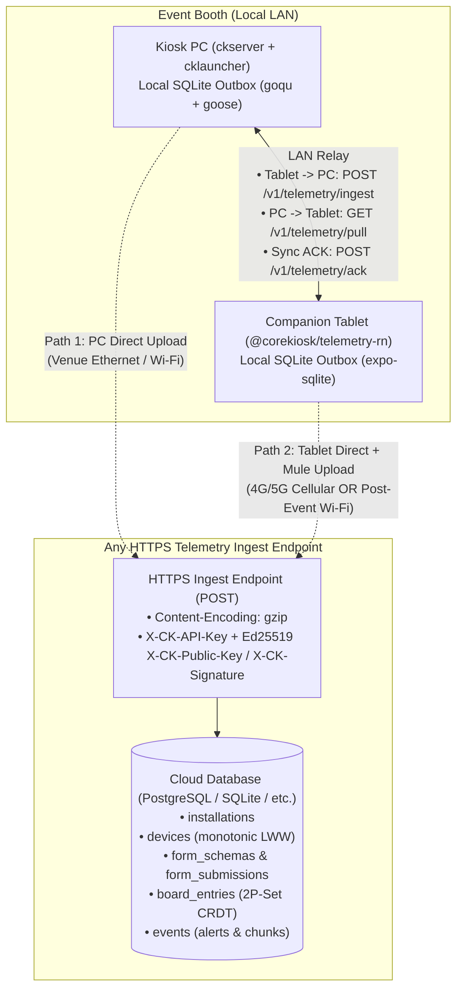

# corekiosk — Local-First Telemetry & Platform-Agnostic Cloud Sync Architecture

`corekiosk` telemetry is **local-first, offline-tolerant, peer-relayed, conflict-free, and platform-agnostic**. Both the Kiosk PC (`ckserver` / `cklauncher`) and Companion Tablets (`@corekiosk/telemetry-rn`) record telemetry independently into local SQLite storage and cooperate as **bidirectional data mules** so data reaches any configured HTTPS telemetry ingest endpoint regardless of which device has internet access.

---

## 1. Real-World Booth Connectivity Topologies

Live brand activations routinely operate in four network states. `corekiosk` handles all four automatically with zero operator intervention:



| Topology | What Happens Automatically |
| :--- | :--- |
| **A. PC online, Tablet LAN-only** | Tablet pushes its telemetry outbox to `ckserver` over LAN (`/v1/telemetry/ingest`). `ckserver` stores it locally and uploads both PC + Tablet records to the configured HTTPS ingest URL. |
| **B. PC LAN-only (air-gapped), Tablet has 4G/5G** | `ckserver` advertises `cloud_online: false` in `/v1/health` & WS snapshots. Tablet pulls un-synced server outbox batches (`/v1/telemetry/pull`), saves them into its own `expo-sqlite`, uploads them to the cloud endpoint over cellular, and ACKs back (`/v1/telemetry/ack`). |
| **C. Both offline during event** | Both nodes keep writing safely to local SQLite. Whichever device gets internet first (hours or days later—even when no longer on the same LAN!) flushes its own outbox AND any peer records it previously cached. |
| **D. Both online simultaneously** | Both upload directly without coordination. Deterministic ULID event/submission IDs guarantee **zero conflicts and zero duplicates** even if both upload the exact same relayed record at the exact same millisecond. |

---

## 2. Platform-Agnostic HTTP Ingest Contract

Any HTTPS endpoint (Supabase Edge Function, self-hosted `cktelemetry-server`, AWS Lambda, Cloud Run, etc.) can serve as a `corekiosk` telemetry backend by accepting `POST` requests with the following headers and body:

### Request Headers
| Header | Description |
| :--- | :--- |
| `Content-Type` | `application/json` |
| `Content-Encoding` | `gzip` (when sent by `cktelemetry.Shipper`) |
| `X-CK-Device-ID` | 16-char hex fingerprint (`hex(sha256(pubKey32Bytes)[:8])`) of the sender device |
| `X-CK-Installation-ID` | 16-char hex `server_id` of the kiosk installation |
| `X-CK-Public-Key` | Base64-encoded 32-byte Ed25519 public key of the sender |
| `X-CK-Signature` | Base64-encoded 64-byte Ed25519 signature over the uncompressed JSON request body |
| `X-CK-API-Key` | Optional shared secret configured via `CK_TELEMETRY_API_KEY` or `cklauncher` |
| `X-CK-Timestamp` | Unix timestamp in milliseconds when the batch was sent |

### Request Body (`BatchEnvelope`)
```json
{
  "installation_id": "8f3a1c2b9d4e5f60",
  "app_name": "joyland-essential",
  "sender_device_id": "8f3a1c2b9d4e5f60",
  "sent_at_ms": 1732680000000,
  "events": [
    {
      "event_id": "01JDM...",
      "origin_device_id": "8f3a1c2b9d4e5f60",
      "origin_role": "server",
      "origin_boot_id": "a1b2c3d4e5f6",
      "origin_seq": 1,
      "category": "form",
      "kind": "form.submission",
      "severity": "info",
      "occurred_at_ms": 1732679995000,
      "payload": {}
    }
  ]
}
```

### Expected Response (`200 OK`)
```json
{
  "accepted_ids": ["01JDM..."],
  "server_ms": 1732680000123
}
```

---

## 3. Configuring & Testing in `cklauncher` or via Environment Variables

You can configure the endpoint either via environment variables or live inside **`cklauncher`'s Telemetry tab** (persisted in SQLite across restarts):

- **In `cklauncher` UI**:
  Open the **Telemetry** tab → enter **Ingest URL**, optional **API Key**, **Interval (s)**, and **Batch Size** → click **Test Connection** (sends a signed, gzipped `telemetry.test_ping` batch and displays the HTTP status code and round-trip latency in `ms`).
- **Environment Variables**:
  - Go (`ckserver`): `CK_TELEMETRY_URL` and `CK_TELEMETRY_API_KEY`
  - Expo / React Native (`@corekiosk/rn`): `EXPO_PUBLIC_TELEMETRY_URL` and `EXPO_PUBLIC_TELEMETRY_API_KEY`

---

## 4. Reference Cloud Backend (`supabase/`)

See [`supabase/README.md`](./supabase/README.md) for the included paste-and-run PostgreSQL schema (`installations`, `devices`, `form_schemas`, `form_submissions`, `board_entries`, `events`, `player_leads_view`, `prize_tallies_view`, and atomic `ck_ingest_batch` RPC) + zero-dependency Edge Function (`supabase/functions/telemetry/index.ts`).
