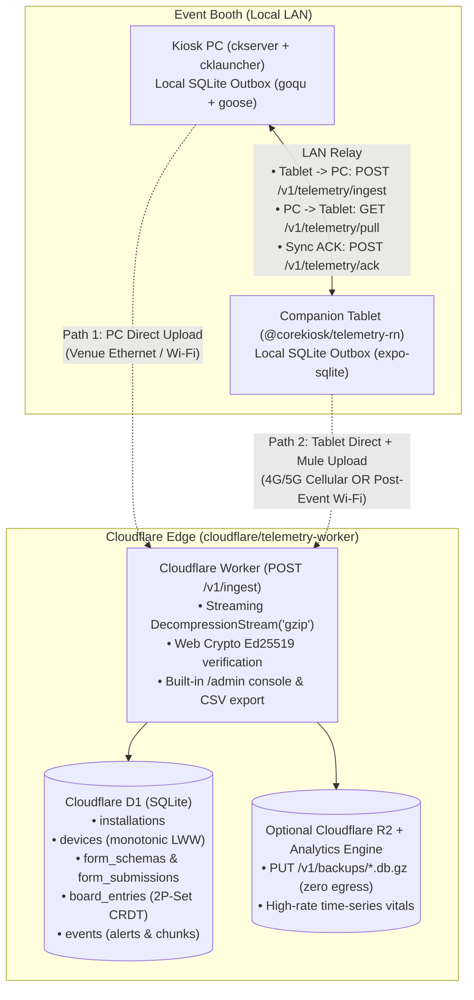

# corekiosk — Local-First Telemetry & Cloudflare Worker + D1 Architecture

`corekiosk` telemetry is **local-first, offline-tolerant, peer-relayed, and conflict-free** when syncing to the cloud. Both the Kiosk PC (`ckserver` / `cklauncher`) and Companion Tablets (`@corekiosk/telemetry-rn`) record telemetry independently into local SQLite storage and cooperate as **bidirectional data mules** so data reaches your **Cloudflare Worker + D1 (SQLite)** backend regardless of which device has internet access.

---

## 1. Real-World Booth Connectivity Topologies

Live brand activations routinely operate in four network states. `corekiosk` handles all four automatically with zero operator intervention:



| Topology | What Happens Automatically |
| :--- | :--- |
| **A. PC online, Tablet LAN-only** | Tablet pushes its telemetry outbox to `ckserver` over LAN (`/v1/telemetry/ingest`). `ckserver` stores it locally and uploads both PC + Tablet records to the Cloudflare Worker. |
| **B. PC LAN-only (air-gapped), Tablet has 4G/5G** | `ckserver` advertises `cloud_online: false` in `/v1/health` & WS snapshots. Tablet pulls un-synced server outbox batches (`/v1/telemetry/pull`), saves them into its own `expo-sqlite`, uploads them to the Cloudflare Worker over cellular, and ACKs back (`/v1/telemetry/ack`). |
| **C. Both offline during event** | Both nodes keep writing safely to local SQLite. Whichever device gets internet first (hours or days later—even when no longer on the same LAN!) flushes its own outbox AND any peer records it previously cached. |
| **D. Both online simultaneously** | Both upload directly without coordination. Deterministic IDs and single-statement SQLite `ON CONFLICT` clauses guarantee **zero conflicts and zero duplicates** even if both upload the exact same relayed record at the exact same millisecond. |

---

## 2. Why Cloudflare Workers + D1 Over Firestore

`corekiosk` already uses **SQLite** on the Kiosk PC (`modernc.org/sqlite` + `goqu` + `goose`) and on Companion Tablets (`expo-sqlite`). Running **Cloudflare D1 (edge SQLite)** in the cloud means **SQLite end-to-end**:

1. **Zero Cold Starts & Zero Runtime Dependencies**: `cloudflare/telemetry-worker` uses native Web Platform APIs (`DecompressionStream("gzip")`, `crypto.subtle` Ed25519, `env.DB.batch`) — zero npm runtime packages and sub-millisecond edge isolates globally.
2. **Self-Certifying Ed25519 Verification**: Every `corekiosk` device ID is `hex(sha256(pubKey32Bytes)[:8])`. Both Go (`cktelemetry.Shipper`) and RN (`MuleSyncEngine`) attach `X-CK-Public-Key` and `X-CK-Signature` headers, allowing the Worker to verify key ownership and batch authenticity from packet #1 (and pin keys via TOFU in `devices.public_key`) with zero cloud service-account credentials on booth hardware.
3. **Atomic Single-Statement Conflict Resolution in SQL**: Instead of multi-roundtrip read-before-write transactions, D1 resolves every CRDT and out-of-order merge inside atomic `env.DB.batch([...])` SQL statements:
   - **Events & Chunks (`events`)**: `INSERT OR IGNORE INTO events ...` by deterministic `event_id` / `chunk_id`.
   - **Out-of-Order Submissions & Prize Outcomes (`form_submissions`)**: If a Tablet Mule uploads `form.outcome` *before* the Kiosk PC uploads `form.submission`, `ON CONFLICT(installation_id, submission_id) DO UPDATE` preserves `COALESCE(outcome_json)` and `COALESCE(NULLIF(fields_json, '{}'))` while indexing `score`, `reward_id`, and `reward_title` for instant SQL prize-redemption tallies.
   - **Monotonic Device LWW (`devices`)**: Single-statement `CASE WHEN (excluded.origin_boot_ts_ms > devices.origin_boot_ts_ms) OR (excluded.origin_boot_ts_ms = devices.origin_boot_ts_ms AND excluded.origin_seq >= devices.origin_seq)` drops stale relayed heartbeats automatically.
   - **2P-Set CRDT Boards (`board_entries`)**: `removed_at_ms = COALESCE(board_entries.removed_at_ms, excluded.removed_at_ms)` ensures moderation tombstones always win regardless of arrival order.
4. **Built-In Reporting Console & RFC-4180 CSV Export**: Visit `GET /admin` on the Worker URL (protected by `ADMIN_TOKEN` Bearer auth or Cloudflare Access JWT headers) to inspect installations, paired device health, prize-tier redemption counts, and 1-click lead CSV exports without deploying a separate frontend.

---

## 3. Deploying `cloudflare/telemetry-worker`

[](https://deploy.workers.cloudflare.com/?url=https://github.com/GecEnterprises/corekiosk/tree/main/cloudflare/telemetry-worker)

See [`cloudflare/telemetry-worker/README.md`](./cloudflare/telemetry-worker/README.md) for 1-click and CLI setup instructions:

```bash
cd cloudflare/telemetry-worker
npm install

# 1. Provision D1 database & apply SQLite schema
npx wrangler d1 create corekiosk-telemetry
# Paste the returned database_id into wrangler.toml
npm run db:migrate:remote

# 2. Configure ingest & admin secrets
npx wrangler secret put CK_INGEST_API_KEYS
npx wrangler secret put ADMIN_TOKEN

# 3. Deploy to Cloudflare
npm run deploy
```

Then configure your kiosk server and companion app:

- **Go (`ckserver`)**:
  ```bash
  CK_TELEMETRY_URL=https://corekiosk-telemetry.<subdomain>.workers.dev/v1/ingest
  CK_TELEMETRY_API_KEY=<your-ingest-key>
  ```
- **Expo / React Native (`@corekiosk/rn` `<KioskProvider>`)**:
  ```bash
  EXPO_PUBLIC_TELEMETRY_URL=https://corekiosk-telemetry.<subdomain>.workers.dev/v1/ingest
  EXPO_PUBLIC_TELEMETRY_API_KEY=<your-ingest-key>
  ```

---

## 4. What Telemetry Is Logged (Wi-Fi, Battery, Link & Booth Health)

### A. Wi-Fi & Network Behavior (Tablet + PC)
Events fire **immediately** on state transitions, while signal quality is sampled periodically (default every **30s**) and packed into chunks:

| Event / Metric `kind` | Trigger | Key Payload Fields |
| :--- | :--- | :--- |
| `net.wifi_connected` | Wi-Fi link up | `ssid`, `bssid`, `ip`, `gateway`, `rssi_dbm`, `freq_mhz` (2.4 vs 5GHz), `link_speed_mbps` |
| `net.wifi_disconnected` | Wi-Fi dropped | `prev_ssid`, `prev_bssid`, `connected_duration_ms`, `last_rssi_dbm`, `reason` |
| `net.wifi_roamed` | **BSSID changed** while same SSID | `ssid`, `from_bssid`, `to_bssid`, `rssi_before`, `rssi_after` *(catches mall/venue AP roaming drops!)* |
| `net.transport_changed` | Active route flipped | `from` (`wifi`/`cellular`/`none`), `to`, `internet_reachable`, `local_lan_reachable` |
| `net.ip_changed` | DHCP lease / subnet change | `old_ip`, `new_ip`, `interface` |
| `net.wifi_sample` *(chunked)* | Every 30s | `ssid`, `bssid`, `rssi_dbm`, `link_speed_mbps`, `freq_mhz`, `internet_reachable`, `packet_loss_hint` |
| `ws.connected` | Tablet ↔ Server WS up | `server_ip`, `reconnect_attempt`, `downtime_ms`, `auth_ms` |
| `ws.disconnected` | Tablet ↔ Server WS drop | `close_code`, `reason`, `session_duration_ms`, `wifi_connected`, `rssi_dbm` |
| `ws.link_sample` *(chunked)* | Every 30s | `rtt_p50_ms`, `rtt_p95_ms`, `clock_offset_ms`, `rx_events`, `tx_events` |

### B. Battery, Power & Thermal (Tablet + Laptop/UPS PC)
Sampled every **60s** (chunked) plus immediate threshold events:

| Event / Metric `kind` | Trigger | Key Payload Fields |
| :--- | :--- | :--- |
| `battery.sample` *(chunked)* | Every 60s | `level_pct`, `is_charging`, `plug_type` (`ac`/`usb`/`wireless`/`none`), `temp_c`, `voltage_mv`, `low_power_mode` |
| `battery.unplugged` | Power lost (`warn`) | `level_pct`, `temp_c` *(catches kicked booth power cables immediately!)* |
| `battery.plugged_in` | Power restored (`info`) | `level_pct`, `plug_type` |
| `battery.low` | Crossed `< 20%` (`warn`) | `level_pct`, `is_charging`, `drain_rate_pct_per_hr` |
| `battery.critical` | Crossed `< 10%` (`critical`) | `level_pct`, `is_charging` |
| `battery.overheat` | Crossed `> 42°C` (`warn`/`critical`) | `temp_c`, `is_charging` *(crucial for tablets sealed in acrylic kiosk stands)* |

### C. Kiosk PC, Game Process & Activation Health (`cklauncher` + `ckserver`)
- `launcher.boot` / `launcher.shutdown` (OS version, app version, `boot_id`, display resolution)
- `launcher.game_started` / `launcher.game_exited` / `launcher.game_crashed` (`exit_code`, `uptime_s`, `restart_count`, tail of stderr)
- `bridge.connected` / `bridge.disconnected` (Godot loopback link drops)
- `system.vitals` *(chunked every 60s)* (`cpu_pct`, `ram_used_mb`, `disk_free_gb`, `game_running`, `connected_tablets`)
- **Operational Audit Events**: `operator.login`, `operator.login_failed`, `config.changed`, `action.triggered`, `board.entry_removed`, `device.paired`, `device.revoked`.

---

## 5. Bidirectional Relay & Sync Wire Protocol

```mermaid
sequenceDiagram
    participant PC as ckserver (PC — Offline from Internet)
    participant Tab as @corekiosk/telemetry-rn (Tablet — Has 4G/5G)
    participant CF as Cloudflare Worker -> D1 SQLite

    Note over PC,Tab: 1. PC reports cloud_online: false in /v1/health & WS snapshot
    Tab->>PC: GET /v1/telemetry/pull?after_seq=1420&limit=200<br/>(Device Auth; includes unsynced events, chunks & submissions)
    PC-->>Tab: 200 OK { items: [...], max_seq: 1580, has_more: false }
    Tab->>Tab: INSERT OR IGNORE into local expo-sqlite outbox<br/>(relayed_from = server_id)

    Note over Tab,CF: 2. Tablet flushes local + relayed rows over 4G/5G (or later Wi-Fi)
    Tab->>CF: POST /v1/ingest (gzipped JSON batch, X-CK-Public-Key + X-CK-Signature)
    CF->>CF: Verify Ed25519 sig + atomic env.DB.batch([...]) upserts
    CF-->>Tab: 200 OK { accepted_ids: ["evt_...", "sub_..."] }
    Tab->>Tab: Mark accepted_ids cloud_synced_at_ms = now

    Note over Tab,PC: 3. Tablet ACKs back to PC on LAN so PC knows they are safe in D1
    Tab->>PC: POST /v1/telemetry/ack { synced_event_ids: [...], up_to_seq: 1580 }
    PC->>PC: Mark matching outbox rows cloud_synced_at_ms = now
```

---

## 6. Cloudflare D1 Relational Schema (`migrations/0001_init.sql`)

| D1 Table | Primary Key | Conflict / Sync Strategy |
| :--- | :--- | :--- |
| `installations` | `installation_id` (`server_id`) | Upsert latest `app_name`, `venue`, `versions_json`, `last_seen_ms` |
| `devices` | `(installation_id, device_id)` | TOFU `public_key` pin + single-statement monotonic LWW on `(origin_boot_ts_ms, origin_seq)` |
| `form_schemas` | `(installation_id, form_id, form_version)` | `INSERT OR IGNORE` column schema snapshot |
| `form_submissions` | `(installation_id, submission_id)` | Out-of-order safe merge of `form.submission` + `form.outcome` (`score`, `reward_id`, `reward_title`) |
| `board_entries` | `(installation_id, board_id, entry_id)` | 2P-Set CRDT (`removed_at_ms` tombstone always wins) |
| `events` | `event_id` | Immutable `INSERT OR IGNORE` for discrete alerts, audits, and packed metric chunks |

---

## 7. Implementation Packages in `corekiosk`

- **Cloudflare Worker (`cloudflare/telemetry-worker/`)**:
  - `src/index.ts`: Zero-dependency Worker handling `POST /v1/ingest`, `PUT /v1/backups/:installation_id/:filename` (optional R2), `GET /admin` console, and `/v1/admin/*` JSON + RFC-4180 CSV endpoints.
  - `migrations/0001_init.sql`: D1 SQLite schema & indexes.
  - `test/worker.test.ts`: End-to-end test suite against `node:sqlite` (`DatabaseSync` D1 adapter) covering Ed25519 signature verification, gzipped ingest, out-of-order Tablet Mule `form.outcome` merge, prize tallies, and CSV export.
- **Go (`go/cktelemetry/`)**:
  - `outbox.go`: SQLite outbox (`goose` migrations + `goqu` queries), ULID generator, chunk sealer.
  - `shipper.go`: Background HTTPS gzipped batch uploader signing payloads with `X-CK-Public-Key` + `X-CK-Signature`, exponential backoff, and `cloud_online` signal.
  - `collectors_windows.go`: Windows Wi-Fi (`netsh` + WLAN event log), CPU/RAM/disk, and AC/battery status collector.
- **React Native (`js/packages/telemetry-rn/`)**:
  - `outbox.ts`: `expo-sqlite` local outbox matching the server schema & chunker.
  - `muleSync.ts`: Bidirectional LAN push/pull/ACK + Ed25519-signed cloud batch upload (`telemetryIngestUrl` / `telemetryApiKey`).
- **`cklauncher` (`go/cklauncher/`)**:
  - Offline Telemetry Explorer UI backed by local SQLite, with 1-click Force Cloud Sync and CSV export.
