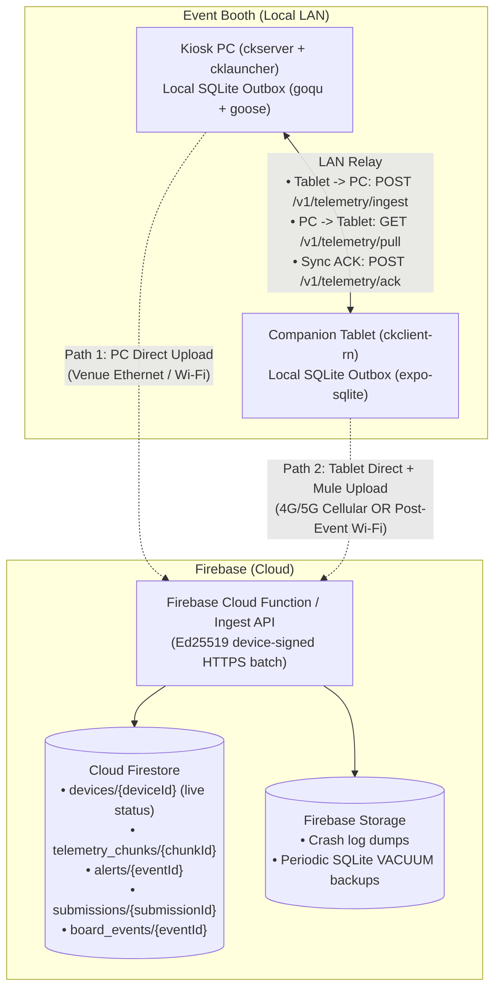

# corekiosk — Local-First Telemetry & Firebase Sync Architecture

`corekiosk` telemetry is **local-first, offline-tolerant, peer-relayed, and conflict-free** when syncing to Firebase. Both the Kiosk PC (`ckserver` / `cklauncher`) and Companion Tablets (`ckclient-rn`) record telemetry independently into local SQLite storage and cooperate as **bidirectional data mules** so data reaches Firebase regardless of which device has internet access.

---

## 1. Real-World Booth Connectivity Topologies

Live brand activations routinely operate in four network states. `corekiosk` handles all four automatically with zero operator intervention:



| Topology | What Happens Automatically |
| :--- | :--- |
| **A. PC online, Tablet LAN-only** | Tablet pushes its telemetry outbox to `ckserver` over LAN (`/v1/telemetry/ingest`). `ckserver` stores it locally and uploads both PC + Tablet records to Firebase. |
| **B. PC LAN-only (air-gapped), Tablet has 4G/5G** | `ckserver` advertises `cloud_online: false` in `/v1/health` & WS snapshots. Tablet pulls un-synced server outbox batches (`/v1/telemetry/pull`), saves them into its own `expo-sqlite`, uploads them to Firebase over cellular, and ACKs back (`/v1/telemetry/ack`). |
| **C. Both offline during event** | Both nodes keep writing safely to local SQLite. Whichever device gets internet first (hours or days later—even when no longer on the same LAN!) flushes its own outbox AND any peer records it previously cached. |
| **D. Both online simultaneously** | Both upload directly without coordination. Deterministic IDs guarantee **zero conflicts and zero duplicates** even if both upload the exact same relayed record at the exact same millisecond. |

### Android Dual-Network Tip (Air-Gapped Booth Wi-Fi + Cellular Mule)
On Android tablets connected to a **no-internet booth Wi-Fi router** with a **4G/5G SIM installed**:
- `@corekiosk/telemetry-rn` can use a tiny Expo native module calling Android's `ConnectivityManager.requestNetwork(TRANSPORT_CELLULAR)` for Firebase uploads while keeping `TRANSPORT_WIFI` bound for LAN traffic to `ckserver`.
- If the tablet is Wi-Fi-only, it simply caches pulled server batches locally and flushes them as soon as someone connects the tablet to a hotspot or venue Wi-Fi at the end of the day.

---

## 2. How Conflicts Are Prevented in Firebase

**Golden Rule**: Never sync raw SQLite `.db` files for merging, never use auto-generated Firestore IDs (`addDoc`), and never use non-idempotent increments (`FieldValue.increment`) on retried writes.

Instead, `corekiosk` uses **three mathematically conflict-free sync patterns**:

### Pattern 1 — Immutable Append-Only Records (Telemetry Events, Alerts, Submissions)
- Every event and every form submission gets a **globally unique, origin-generated deterministic ID** (ULID / UUIDv7) the moment it is created locally (`evt_01J...`, `sub_01J...`).
- That exact ID is preserved across every LAN relay hop and used as the **Firestore Document ID**:
  - `orgs/{orgId}/installations/{serverId}/submissions/{submissionId}`
  - `orgs/{orgId}/installations/{serverId}/alerts/{eventId}`
- Writes use **`create`-only semantics** (never overwrite):
  - If PC and Tablet both try to upload `sub_01J9X...`, the first succeeds and the second receives `ALREADY_EXISTS`.
  - Both uploader implementations treat `ALREADY_EXISTS` as **HTTP 200 / Synced** and mark the local outbox row `cloud_synced_at_ms = now`.

### Pattern 2 — Deterministic Telemetry Chunks (Cost Control + Idempotency)
High-frequency metrics (Wi-Fi RSSI, battery %, RTT samples) would burn unnecessary Firestore writes if written 1 doc per sample.
- The **origin device** seals metrics into immutable **chunks** (every 50 samples or every 5 minutes, whichever comes first) with a deterministic ID:
  - `chunk_id = "{origin_device_id}_{origin_boot_id}_{start_seq}_{end_seq}"`
  - Firestore path: `orgs/{orgId}/installations/{serverId}/telemetry_chunks/{chunkId}`
- Cuts Firestore write volume by **50×–100×** while staying 100% idempotent when relayed by a peer.

### Pattern 3 — Single-Writer Device Status & Tombstone-Wins Boards
- **Live Status Cards** (`orgs/{orgId}/installations/{serverId}/devices/{deviceId}`):
  - Each device (`server_id` or `client_id`) owns its own document—two devices never contend on the same status doc.
  - Every status payload carries a monotonic `(origin_boot_ts_ms, origin_seq)`.
  - Even if a stale relayed heartbeat arrives *after* a newer direct heartbeat, the ingest transaction compares `(origin_boot_ts_ms, origin_seq)` and **drops stale writes** (monotonic LWW).
- **Curated Boards / Leaderboards** (`board_entries`):
  - Because `corekiosk` boards are **create + delete-only** (never edited), each entry syncs as a **2P-Set CRDT**: `board.entry_added` creates the doc, and `board.entry_removed` sets `removed_at_ms` + `removed_by_operator_id`. A tombstone (`removed_at_ms != null`) always wins regardless of arrival order.

### What About SQLite Domain Data Sync & `CKTelemetryTransmit` Forms?
- **Every `ckframework` form defaults to `CKTelemetryTransmit` (`TelemetryTransmit: true`)** — opt-out via `.WithoutTelemetryTransmit()` only for NDA/strict-local-only events.
- When a form entry is submitted, `ckserver` writes it **atomically in one SQLite transaction** to both:
  1. `submissions` (immutable local ledger for tablet History & CSV export), and
  2. `telemetry_outbox` (`category = "form"`, `kind = "form.submission"`, tagged with `form_id`, `form_version`, `source_device_id`, and typed form fields).
- **Table-Shaped in Firebase (Not a Log Stream)**: Unlike diagnostic logs/chunks, Firebase routes `form.submission` records into a dedicated **structured table collection per form** (`forms/{formId}/rows/{submissionId}`) alongside a schema doc (`forms/{formId}`) so event clients and dashboards can query, filter, sort, and export forms like a proper spreadsheet/table (and easily pipe to BigQuery).

| SQLite Table | Synced to Firebase? | Firestore Shape & Conflict Strategy |
| :--- | :--- | :--- |
| `submissions` (`CKTelemetryTransmit` ON by default) | **Yes** (real-time / mule) | **Table collection** `forms/{formId}/rows/{submissionId}` — `create`-only by `submission.id` (immutable form fields; optional outcome merge once) |
| `devices` (PC + paired tablet hardware profiles) | **Yes** (on pair & reconnect) | **Registry + live card** `devices/{deviceId}` — single-writer monotonic LWW |
| `rounds` (game outcomes) | **Yes** (on terminal state: `finished`/`cancelled`/`interrupted`) | `create`-only by `round.id` (also attaches outcome to its linked form row) |
| `board_entries` (leaderboards / walls) | **Yes** (add + tombstone events) | 2P-Set CRDT (tombstone always wins) |
| `settings` (config revisions) | **Optional** (audit event on revision change) | `create`-only by `{server_id}_rev_{N}` |
| `telemetry_outbox` (metrics & alerts) | **Yes** (chunks + discrete alerts) | `create`-only by deterministic `chunk_id` / `event_id` |
| `operators` / private keys | **No** (private keys & password hashes stay strictly local!) | Only non-sensitive audit events (`operator.login`, `device.paired`) sync |
| Full `.db` Disaster Backup | **Optional** (daily `VACUUM INTO` gzip) | Immutable blob in Firebase Storage `backups/{serverId}/{ts}.db.gz` |

---

## 3. Recommended Firebase Integration Architecture

### Recommendation: Thin Firebase Cloud Function Ingest (`POST /v1/ingest`) + Firestore

Rather than embedding heavy Firebase Admin/Client SDKs with complex offline caches on both Go and React Native, route all cloud uploads through **one thin Firebase Cloud Function (v2 / Cloud Run)** that writes into **Cloud Firestore** and **Firebase Storage**:

**Why this is strongly recommended over direct SDK writes:**
1. **Reuses `corekiosk`'s Ed25519 device keys**: Both Go (`ckserver`) and RN (`ckclient-rn`) sign the HTTP batch with their persistent Ed25519 private key (plus an installation API token provisioned for the event). No Google Service Account JSON files sitting on public booth PCs!
2. **One deduplication & monotonic-LWW engine**: The Cloud Function runs Firestore `bulkWriter` (`create` ignoring `ALREADY_EXISTS`) and monotonic status updates in one place—no duplicated Security Rules gymnastics.
3. **Firewall & proxy friendly**: Standard HTTPS `POST` with `gzip` compression works reliably on locked-down venue networks and cellular tethers.
4. **Local SQLite stays the single source of truth**: Avoids fighting Firestore SDK's own hidden IndexedDB/SQLite cache on React Native.
5. **Realtime Dashboard still uses native Firestore listeners**: Your web/mobile operations dashboard reads directly from Firestore with `onSnapshot` for instant live booth monitoring!

*(Alternative: If you want zero Cloud Functions during early prototyping, both Go and RN can write directly to Firestore REST API using scoped Firebase Custom Tokens + Firestore Security Rules enforcing `allow create; allow update: if false` on immutable collections.)*

---

## 4. What Telemetry Is Logged (Wi-Fi, Battery, Link & Booth Health)

### A. Wi-Fi & Network Behavior (Tablet + PC)
Events fire **immediately** on state transitions, while signal quality is sampled periodically (default every **30s**) and packed into chunks:

| Event / Metric `kind` | Trigger | Key Payload Fields |
| :--- | :--- | :--- |
| `net.wifi_connected` | Wi-Fi link up | `ssid`, `bssid`, `ip`, `gateway`, `rssi_dbm`, `freq_mhz` (2.4 vs 5GHz), `link_speed_mbps` |
| `net.wifi_disconnected` | Wi-Fi dropped | `prev_ssid`, `prev_bssid`, `connected_duration_ms`, `last_rssi_dbm`, `reason` |
| `net.wifi_roamed` | **BSSID changed** while same SSID | `ssid`, `from_bssid`, `to_bssid`, `rssi_before`, `rssi_after` *(catches mall/venue AP roaming drops!)* |
| `net.transport_changed` | Active route flipped | `from` (`wifi`/`cellular`/`none`), `to`, `internet_reachable`, `local_lan_reachable` |
| `net.ip_changed` | DHCP lease / subnet change | `old_ip`, `new_ip`, `interface` |
| `net.wifi_sample` *(chunked)* | Every 30s | `ssid`, `bssid`, `rssi_dbm`, `link_speed_mbps`, `freq_mhz`, `internet_reachable`, `packet_loss_hint` |
| `ws.connected` | Tablet ↔ Server WS up | `server_ip`, `reconnect_attempt`, `downtime_ms`, `auth_ms` |
| `ws.disconnected` | Tablet ↔ Server WS drop | `close_code`, `reason`, `session_duration_ms`, `wifi_connected`, `rssi_dbm` |
| `ws.link_sample` *(chunked)* | Every 30s | `rtt_p50_ms`, `rtt_p95_ms`, `clock_offset_ms`, `rx_events`, `tx_events` |

### B. Battery, Power & Thermal (Tablet + Laptop/UPS PC)
Sampled every **60s** (chunked) plus immediate threshold events:

| Event / Metric `kind` | Trigger | Key Payload Fields |
| :--- | :--- | :--- |
| `battery.sample` *(chunked)* | Every 60s | `level_pct`, `is_charging`, `plug_type` (`ac`/`usb`/`wireless`/`none`), `temp_c`, `voltage_mv`, `low_power_mode` |
| `battery.unplugged` | Power lost (`warn`) | `level_pct`, `temp_c` *(catches kicked booth power cables immediately!)* |
| `battery.plugged_in` | Power restored (`info`) | `level_pct`, `plug_type` |
| `battery.low` | Crossed `< 20%` (`warn`) | `level_pct`, `is_charging`, `drain_rate_pct_per_hr` |
| `battery.critical` | Crossed `< 10%` (`critical`) | `level_pct`, `is_charging` |
| `battery.overheat` | Crossed `> 42°C` (`warn`/`critical`) | `temp_c`, `is_charging` *(crucial for tablets sealed in acrylic kiosk stands)* |

### C. Kiosk PC, Game Process & Activation Health (`cklauncher` + `ckserver`)
- `launcher.boot` / `launcher.shutdown` (OS version, app version, `boot_id`, display resolution)
- `launcher.game_started` / `launcher.game_exited` / `launcher.game_crashed` (`exit_code`, `uptime_s`, `restart_count`, tail of stderr)
- `bridge.connected` / `bridge.disconnected` (Godot loopback link drops)
- `system.vitals` *(chunked every 60s)* (`cpu_pct`, `ram_used_mb`, `disk_free_gb`, `game_running`, `connected_tablets`)
- **Operational Audit Events**: `operator.login`, `operator.login_failed`, `config.changed`, `action.triggered`, `board.entry_removed`, `device.paired`, `device.revoked`.

---

## 5. Local SQLite Schema: Device Registry & Outbox (`goose` + `goqu`)

### A. Rich Device Registry (`devices` — Paired Keys + Hardware Metadata)
Every paired tablet **and** the kiosk server itself is stored as a structured row in `devices`, linking each Ed25519 key to human-readable hardware & app identity. `@corekiosk/rn` sends this metadata automatically during `POST /v1/pair` and refreshes dynamic fields (`os_version`, `app_version`, `last_ip`) on every reconnect:

```sql
-- 00001_devices_and_outbox.sql (goose migration)
CREATE TABLE devices (
    device_id           TEXT PRIMARY KEY,                  -- sha256(public_key)[:8] key fingerprint
    public_key          TEXT NOT NULL UNIQUE,              -- Persistent Ed25519 public key (base64)
    role                TEXT NOT NULL,                     -- 'server' | 'tablet' | 'operator_tablet'
    device_name         TEXT NOT NULL,                     -- Editable booth label (e.g. "Reg Tablet #1")
    device_type         TEXT NOT NULL,                     -- 'android_tablet' | 'ipad' | 'android_phone' | 'windows_pc' | 'web'
    manufacturer        TEXT NOT NULL DEFAULT '',          -- e.g. "Samsung", "Apple", "Lenovo"
    model               TEXT NOT NULL DEFAULT '',          -- e.g. "SM-X710", "iPad14,3"
    os_name             TEXT NOT NULL DEFAULT '',          -- e.g. "Android", "iOS", "Windows"
    os_version          TEXT NOT NULL DEFAULT '',          -- e.g. "14", "11 23H2"
    app_version         TEXT NOT NULL DEFAULT '',          -- Brand client/server app version (e.g. "1.4.2")
    framework_version   TEXT NOT NULL DEFAULT '',          -- ckframework / @corekiosk/client SemVer (e.g. "1.2.0")
    launcher_version    TEXT NOT NULL DEFAULT '',          -- cklauncher SemVer+commit (server row only)
    game_version        TEXT NOT NULL DEFAULT '',          -- Active game binary SemVer (server row only)
    protocol_version    INTEGER NOT NULL DEFAULT 1,        -- Integer wire protocol version (see VERSIONING.md)
    device_info_json    TEXT NOT NULL DEFAULT '{}',        -- Extensible hardware info (screen res, RAM, game sha256, etc.)
    allow_cloud_relay   INTEGER NOT NULL DEFAULT 1,        -- Whether this device may mule server data to Firebase
    last_ip             TEXT NOT NULL DEFAULT '',
    paired_at_ms        INTEGER NOT NULL,
    last_seen_at_ms     INTEGER NOT NULL,
    revoked_at_ms       INTEGER                            -- NULL = active; set = key revoked
);
```

Because `telemetry_outbox.origin_device_id` references `devices.device_id`, every `goqu` query in `ckserver` and `cklauncher` joins cleanly to display **who** sent an event (`Server` vs `Client`, which client key, device name, model, and OS).

### B. Telemetry Outbox (`telemetry_outbox` & Peer Cursors)
Both `ckserver` (Go SQLite via `goose` + `goqu`) and `ckclient-rn` (`expo-sqlite`) mirror the same core outbox model:

```sql
CREATE TABLE telemetry_outbox (
    seq                 INTEGER PRIMARY KEY AUTOINCREMENT, -- Local monotonic cursor for LAN pull
    event_id            TEXT NOT NULL UNIQUE,              -- Global ULID/UUIDv7 (idempotency key)
    origin_device_id    TEXT NOT NULL,                     -- FK-style ref -> devices.device_id (server_id or client_id)
    origin_role         TEXT NOT NULL,                     -- 'server' | 'tablet' | 'game'
    origin_boot_id      TEXT NOT NULL,
    origin_seq          INTEGER NOT NULL,
    category            TEXT NOT NULL,                     -- 'wifi' | 'battery' | 'ws' | 'launcher' | 'form' | 'board' | 'audit'
    kind                TEXT NOT NULL,                     -- e.g. 'net.wifi_roamed', 'battery.unplugged', 'form.submission'
    severity            TEXT NOT NULL DEFAULT 'info',      -- 'debug' | 'info' | 'warn' | 'error' | 'critical'
    occurred_at_ms      INTEGER NOT NULL,
    payload_json        TEXT NOT NULL,
    relayed_from        TEXT,                              -- NULL if originated locally; peer device_id if relayed
    cloud_synced_at_ms  INTEGER,                           -- NULL until Firebase confirms persistence
    sync_attempts       INTEGER NOT NULL DEFAULT 0,
    last_sync_error     TEXT
);

CREATE INDEX idx_outbox_unsynced ON telemetry_outbox (cloud_synced_at_ms, seq);
CREATE INDEX idx_outbox_origin   ON telemetry_outbox (origin_device_id, origin_seq);
CREATE INDEX idx_outbox_category ON telemetry_outbox (category, occurred_at_ms DESC);

-- Tracks how far each peer has pulled/synced so LAN relay is incremental
CREATE TABLE telemetry_peer_cursors (
    peer_device_id      TEXT PRIMARY KEY,
    last_pulled_seq     INTEGER NOT NULL DEFAULT 0,
    last_acked_seq      INTEGER NOT NULL DEFAULT 0,
    updated_at_ms       INTEGER NOT NULL
);
```

### Retention & Disk Safety Rules
- **Synced rows** (`cloud_synced_at_ms IS NOT NULL`): kept locally for **14 days** (for onsite diagnostics & local export), then pruned automatically by a background `goqu` cleanup job.
- **Unsynced rows**: retained indefinitely until Firebase confirms them. If local storage hits an emergency cap (e.g. > 250 MB on a tablet), prune oldest `debug` / `sample` rows first—**never** drop `submission`, `board`, `audit`, `error`, or `critical` rows.

---

## 6. Bidirectional Relay & Sync Wire Protocol

```mermaid
sequenceDiagram
    participant PC as ckserver (PC — Offline from Internet)
    participant Tab as ckclient-rn (Tablet — Has 4G/5G)
    participant FB as Firebase Ingest -> Firestore

    Note over PC,Tab: 1. PC reports cloud_online: false in /v1/health & WS snapshot
    Tab->>PC: GET /v1/telemetry/pull?after_seq=1420&limit=200<br/>(Device Auth; includes unsynced events, chunks & submissions)
    PC-->>Tab: 200 OK { items: [...], max_seq: 1580, has_more: false }
    Tab->>Tab: INSERT OR IGNORE into local expo-sqlite outbox<br/>(relayed_from = server_id)

    Note over Tab,FB: 2. Tablet flushes local + relayed rows over 4G/5G (or later Wi-Fi)
    Tab->>FB: POST /v1/ingest (gzipped JSON batch, Ed25519 signed)
    FB->>FB: bulkWriter.create() by deterministic event_id / chunk_id / submission_id<br/>(ALREADY_EXISTS -> treated as accepted!)
    FB-->>Tab: 200 OK { accepted_ids: ["evt_...", "sub_..."] }
    Tab->>Tab: Mark accepted_ids cloud_synced_at_ms = now

    Note over Tab,PC: 3. Tablet ACKs back to PC on LAN so PC knows they are safe in Firebase
    Tab->>PC: POST /v1/telemetry/ack { synced_event_ids: [...], up_to_seq: 1580 }
    PC->>PC: Mark matching outbox rows cloud_synced_at_ms = now
```

### Reverse Direction (PC Online, Tablet LAN-Only)
1. Tablet posts its unsynced rows to `POST /v1/telemetry/ingest` on `ckserver`.
2. `ckserver` executes `INSERT OR IGNORE` into its `telemetry_outbox` (`relayed_from = tablet.client_id`) and returns `{ accepted_ids: [...] }`.
3. Tablet marks those rows `relayed_to_server_at_ms = now` (or `cloud_synced_at_ms` once `ckserver` broadcasts cloud sync confirmation over WS).
4. `ckserver`'s background shipper batches and uploads them to Firebase with exponential backoff + jitter (e.g., `5s → 15s → 60s → 5m`).

---

## 7. Firestore Data Layout

```text
orgs/{orgId}/
└── installations/{serverId}/                     # 1 doc per kiosk PC (Ed25519 server_id)
    ├── (doc fields: app_name, versions: { app, framework, launcher, game, protocol }, venue, last_seen_ms, active_phase)
    ├── devices/{deviceId}                        # Hardware profile + live status per PC & Tablet (monotonic LWW)
    │   └── { role, device_name, device_type, manufacturer, model, os_name, os_version,
    │         versions: { app, framework, launcher?, game?, protocol }, battery_pct, is_charging,
    │         temp_c, ssid, bssid, rssi_dbm, ip, ws_connected, game_running, origin_boot_ts_ms, origin_seq }
    ├── forms/{formId}                            # Form table schema doc (columns, labels, types from ckframework)
    │   └── rows/{submissionId}                   # TABLE-SHAPED form rows (CKTelemetryTransmit, create-only)
    │       └── { _submission_id, _created_at_ms, _source_device_id, _source_device_name,
    │             _round_id?, _status, _outcome?, name, ig_username, email, ... }
    ├── alerts/{eventId}                          # Discrete high-signal events (crashes, Wi-Fi drops, power loss, audits)
    ├── telemetry_chunks/{chunkId}                # Packed 30s/60s Wi-Fi + battery + vitals samples (50-100/doc)
    └── boards/{boardId}/
        └── entries/{entryId}                     # 2P-Set CRDT (created + optional removed_at_ms tombstone)
```

> **Why `forms/{formId}/rows/{submissionId}` is structured as a table**: Each form row stores its `ckframework` fields as typed fields right on the document (e.g., `name`, `ig_username`, `email`, `flavor`, `message`) plus underscored system columns (`_source_device_id`, `_source_device_name`, `_created_at_ms`, `_outcome`). That makes Firebase Console browsing, Firestore `where()` / `orderBy()` queries, CSV exports, and Firebase→BigQuery table streaming work out of the box—unlike digging through an unstructured log stream.

---

## 8. `cklauncher` Telemetry Explorer (Local Offline UI)

`cklauncher` includes a built-in **Telemetry Explorer** backed directly by local SQLite (`goqu` queries joining `telemetry_outbox` with `devices`), working 100% offline during booth operations:

1. **Device Fleet Strip (Top Bar)**
   - Shows the Kiosk PC (`server_id`) plus every paired tablet from `devices`: **Device Name**, **Device Type / Model** (`Samsung SM-X710 · Android 14`), **Key Fingerprint** (`8f3a1c2b`), live **Wi-Fi SSID / RSSI / BSSID**, **Battery % + Charging + °C**, **WS Status**, and **Unsynced Queue Count**.
2. **Event Stream Inspector (`Events` Tab)**
   - **Origin Filters**:
     - **Source Type**: `All` | `Server (PC)` | `Client (Tablet)` | `Game`
     - **Specific Device / Key**: picker listing every paired device (`"Reg Tablet #1 — Samsung SM-X710 [8f3a1c2b]"`)
     - **Category & Severity**: `wifi`, `battery`, `ws`, `launcher`, `form`, `board`, `audit` + `warn / error / critical` filter
     - **Sync State**: `All` | `Pending Cloud Sync` | `Synced to Firebase` | `Relayed via Peer`
   - **Row Attribution & Detail Drawer**: Clearly labels each event with **Origin Badge** (`SERVER` vs `CLIENT`), **Device Name & Type**, **Client Key ID**, **Relay Path** (direct vs relayed), **Cloud Sync Status** (`Synced`, `Pending`, or last retry error), and formatted JSON payload.
3. **Form Data Table (`Forms` Tab)**
   - Renders `CKTelemetryTransmit` submissions as a spreadsheet-style table using `ckframework.FormSpec` columns, plus attribution columns (`Submitted By` device name + key, `Timestamp`, `Firebase Sync` badge), search, and **1-click CSV/JSON Export**.
4. **Manual Controls**
   - **Force Sync to Firebase Now** button (triggers immediate shipper flush & shows live batch result) and **Export Diagnostic Bundle (.zip)** (SQLite `VACUUM INTO` snapshot + recent logs for remote support).

---

## 9. Implementation Packages in `corekiosk`

- **Go (`go/cktelemetry/`)**:
  - `outbox.go`: SQLite outbox (`goose` migrations + `goqu` queries), ULID/UUIDv7 generator, chunk sealer.
  - `shipper.go`: Background HTTPS gzipped batch uploader with exponential backoff, circuit breaker, and `cloud_online` status signal.
  - `collectors_windows.go`: Windows Wi-Fi (WLAN API / `netsh` SSID/BSSID/RSSI), CPU/RAM/disk, and AC/battery status collector.
  - `relay.go`: Gin handlers for `/v1/telemetry/ingest`, `/v1/telemetry/pull`, and `/v1/telemetry/ack` (using `errorx`).
- **React Native (`js/packages/telemetry-rn/`)**:
  - `outbox.ts`: `expo-sqlite` local outbox matching the exact same schema & chunker.
  - `wifiCollector.ts`: `@react-native-community/netinfo` + native Android `WifiManager` / `ConnectivityManager` listener (captures SSID, BSSID roaming, RSSI, link speed, 2.4/5GHz, LAN vs internet reachability).
  - `batteryCollector.ts`: `expo-battery` + Android `ACTION_BATTERY_CHANGED` intent (level, charging, plug type, battery temperature °C).
  - `muleSync.ts`: Orchestrates direct Firebase upload, LAN push to `ckserver`, LAN pull from offline `ckserver`, and ACK loop.
- **Firebase (`firebase/functions/`)**:
  - `ingestBatch`: Thin TypeScript Cloud Function v2 verifying Ed25519 device signatures and writing idempotently to Firestore.

- **`cklauncher` (`go/cklauncher/ui/`)**:
  - `telemetry_explorer`: Local offline Telemetry Explorer UI (Device Fleet Strip, Source/Key/Category/Sync filterable Event Inspector, spreadsheet-style Forms Table view, Force Sync & Diagnostic Export).

---

## 10. Open Decisions for Your Review

1. **Firebase Upload Gateway**
   - **A) Thin Firebase Cloud Function `POST /ingestBatch`** *(Recommended)* — Ed25519 device-signed batches, zero Google service-account keys on booth PCs, centralized dedupe, table-routing for `forms/{formId}/rows/{submissionId}`, and monotonic status checks.
   - **B) Direct Firestore SDK / REST** — no Cloud Functions to deploy, relies on Firebase Auth custom tokens + Firestore Security Rules.
2. **Tablet Mule Permission**
   - Should **any paired tablet** automatically act as a Firebase data mule when it detects `server.cloud_online == false`, or only tablets with `devices.allow_cloud_relay = true` (configurable in `cklauncher`)?
