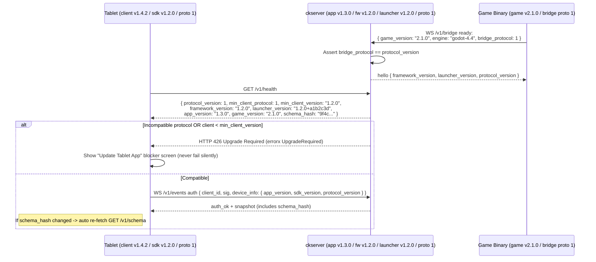

# corekiosk — Versioning & Compatibility Contract

A `corekiosk` deployment runs **four independently buildable artifacts** across two machines (Windows PC + Android/iOS Tablet). Explicit SemVer versioning and handshake checks ensure you always know *what* is running at a venue and prevent silent breakage when one component is updated ahead of another.

---

## 1. The Four Version Tracks (SemVer 2.0.0)

| Track | Scope / Owner | Example | Where It Lives |
| :--- | :--- | :--- | :--- |
| **`ckframework`** | Shared Go schema, wire protocol, `@corekiosk/*` TS/RN packages, `ck_bridge.gd` | `1.2.0` (+ integer `protocol: 1`) | `go/ckframework/version.go` → codegen into `@corekiosk/client` & `adapters/godot/ck_bridge.gd` |
| **`cklauncher`** | Windows supervisor, pre-launch UI, Telemetry Explorer, `ckpack` CLI | `1.2.0+a1b2c3d` | Embedded at build time via Go `-ldflags` (`Version`, `GitCommit`, `BuiltAt`) |
| **`client`** | Brand-specific React Native / Expo tablet app | `1.4.2` (`build: 14`) + `sdk_version: 1.2.0` | `app.json` / `expo-application` (`nativeApplicationVersion`, `nativeBuildVersion`) + `@corekiosk/client` |
| **`game`** | Brand-specific Godot / Unity / Web activation binary | `2.1.0` (`engine: godot-4.4`) + `sha256` | `kiosk.manifest.json`, game project version setting, and WS `/v1/bridge` `ready` handshake |

> **Monorepo Rule (Lockstep for `corekiosk`, Independent for Brand Apps)**:
> All first-party `corekiosk` libraries (`ckframework`, `ckserver`, `cklauncher`, `cktelemetry`, `@corekiosk/client`, `@corekiosk/rn`, `@corekiosk/telemetry-rn`, `ck_bridge.gd`) release **in lockstep** on the same SemVer tag (e.g. `v1.2.0`) so there is never a compatibility matrix between `cklauncher` and `@corekiosk/rn`.
> Each brand activation versions its own `app_version`, `game_version`, and `client_version` independently.

---

## 2. Protocol & Compatibility Matrix

### A. Integer `protocol_version` (Hard Wire Gate)
- Breaking wire-contract changes bump the integer `protocol_version` (`1` → `2`) alongside a `ckframework` **MAJOR** bump (`v1.x` → `v2.0.0`).
- Additive changes (new setting types, optional payload fields, new endpoints) bump `ckframework` **MINOR** (`v1.1.0` → `v1.2.0`) while keeping `protocol_version: 1`.
- Bug fixes bump **PATCH** (`v1.2.0` → `v1.2.1`).

### B. Handshake & Version Negotiation



### C. Graceful Degradation Rules (Within Same `protocol_version`)
- **Unknown JSON fields**: Always ignored on both Go and TypeScript sides.
- **New `SettingSpec` / `ActionSpec` types on a newer server**: An older tablet on the same `protocol_version` renders an unsupported control type as a read-only row (`"Update tablet to edit"`) instead of crashing `OperatorScreen`.
- **`min_client_version` pin**: An activation server can optionally require a minimum brand tablet version via `ckframework.NewApp("essential-pop", "1.3.0").RequireMinClientVersion("1.2.0")` when a brand-specific player screen UI changed.
- **Game binary hash verification**: `ckpack` records `game.sha256` in `kiosk.manifest.json`. If someone hot-swaps `./game/app.exe` onsite, `cklauncher` logs a `version.game_binary_changed` telemetry event and displays a `"Modified binary"` badge (still launches unless strict verification is enabled).

---

## 3. Build-Time Injection & `kiosk.manifest.json`

### A. Go Build Flags (`cklauncher` & `ckframework`)
```powershell
go build -ldflags "-X github.com/GecEnterprises/corekiosk/go/cklauncher.Version=1.2.0 \
  -X github.com/GecEnterprises/corekiosk/go/cklauncher.GitCommit=a1b2c3d \
  -X github.com/GecEnterprises/corekiosk/go/cklauncher.BuiltAt=2026-11-26T07:30:00Z" \
  -o dist/essential-pop/essential-pop-launcher.exe ./server
```

### B. Bundle Manifest (`dist/<app-name>/kiosk.manifest.json`)
Generated automatically by `ckpack` and read by `cklauncher` on boot:

```json
{
  "app_name": "essential-pop",
  "app_version": "1.3.0",
  "ckframework_version": "1.2.0",
  "cklauncher_version": "1.2.0+a1b2c3d",
  "protocol_version": 1,
  "min_client_version": "1.2.0",
  "game": {
    "binary": "./game/app.exe",
    "version": "2.1.0",
    "engine": "godot-4.4",
    "sha256": "e3b0c44298fc1c149afbf4c8996fb924..."
  },
  "built_at": "2026-11-26T07:30:00Z"
}
```

### C. Codegen Lock (`go/ckframework/codegen`)
Running `pnpm codegen` (or `go generate ./...`) emits the exact `ckframework` version and `protocol_version` into:
- `js/packages/client/src/generated/version.ts` (`CK_FRAMEWORK_VERSION`, `CK_PROTOCOL_VERSION`)
- `adapters/godot/ck_bridge.gd` (`const CK_FRAMEWORK_VERSION`, `const CK_PROTOCOL_VERSION`)

CI fails if generated files drift from `go/ckframework/version.go`.

---

## 4. Visibility in Telemetry, SQLite & `cklauncher` UI

- **SQLite `devices` table**: Every device row stores `app_version`, `framework_version` (or `sdk_version`), `protocol_version`, and `device_info_json` (which for the server includes `launcher_version`, `game_version`, and `game_sha256`).
- **Automatic Upgrade Audit Events**: Whenever `cklauncher` or a paired tablet connects with a different version than previously recorded in `devices`, `ckserver` emits a `version.changed` event (`old_version` → `new_version`) into `telemetry_outbox` → Firebase.
- **Firestore Installation & Device Docs**:
  - `installations/{serverId}` exposes `versions: { app, framework, launcher, game, protocol }`.
  - `installations/{serverId}/devices/{deviceId}` exposes `versions: { app, sdk, protocol }` so you can spot an outdated tablet across 20 booths in one glance.
- **`cklauncher` UI & Telemetry Explorer**:
  - Status header always displays all four versions: `Framework v1.2.0 · Launcher v1.2.0 · Game v2.1.0 · App v1.3.0`, plus per-tablet `client` versions in the Device Fleet Strip with an amber warning badge on version drift or red banner on `protocol_version` mismatch.
